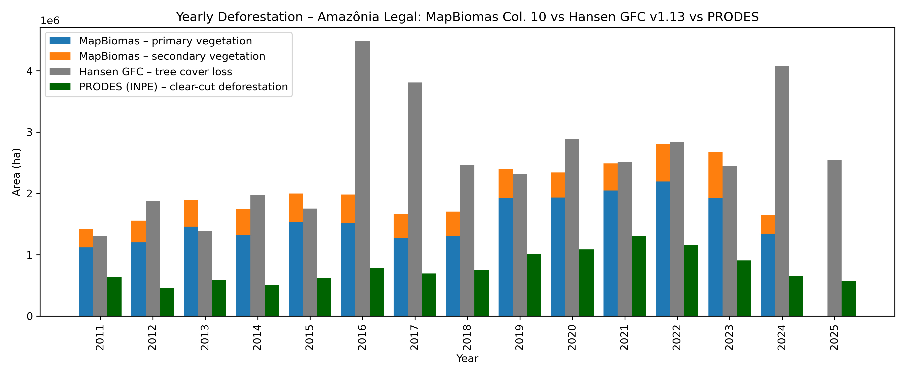
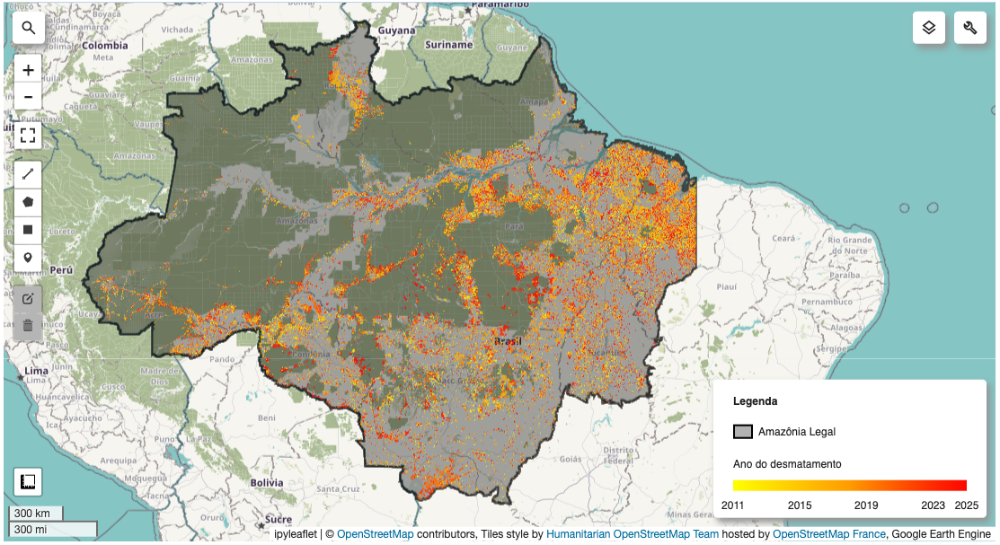

# Deforestation in the Brazilian Legal Amazon (2011–2025)

How much forest is lost in the Amazônia Legal each year? The answer depends on which dataset you ask.
This repository compares the three most widely used sources for 2011–2025:

| Dataset | Producer | What it measures |
|---|---|---|
| **Hansen Global Forest Change v1.13** (shown on Global Forest Watch) | University of Maryland | *Tree cover loss*: any removal of tree canopy (clear-cutting, fire, logging, natural disturbance), 30 m pixels, calendar year |
| **MapBiomas Collection 10**: deforestation and secondary vegetation | MapBiomas | *Suppression of native vegetation* (forest, savanna, grassland), split into primary and secondary vegetation, calendar year, up to 2024 |
| **PRODES** | INPE | Brazil's official *clear-cut deforestation* rate of primary forest, 6.25 ha minimum mapping unit, year runs August–July |



*Portuguese version: [amazonia_mapbiomas_hansen_prodes_pt.png](amazonia_mapbiomas_hansen_prodes_pt.png)*

## Results (km²)

| Year | PRODES | Hansen GFC (tree cover loss) | MapBiomas primary | MapBiomas secondary | MapBiomas total |
|---|---:|---:|---:|---:|---:|
| 2011 | 6,418 | 13,072 | 11,200 | 2,981 | 14,181 |
| 2012 | 4,571 | 18,757 | 12,005 | 3,543 | 15,549 |
| 2013 | 5,891 | 13,817 | 14,590 | 4,291 | 18,881 |
| 2014 | 5,012 | 19,726 | 13,203 | 4,217 | 17,420 |
| 2015 | 6,207 | 17,526 | 15,270 | 4,719 | 19,989 |
| 2016 | 7,893 | 44,844 | 15,149 | 4,663 | 19,811 |
| 2017 | 6,947 | 38,083 | 12,761 | 3,868 | 16,629 |
| 2018 | 7,536 | 24,655 | 13,112 | 3,931 | 17,043 |
| 2019 | 10,129 | 23,122 | 19,273 | 4,751 | 24,024 |
| 2020 | 10,851 | 28,792 | 19,342 | 4,083 | 23,425 |
| 2021 | 13,038 | 25,124 | 20,484 | 4,416 | 24,900 |
| 2022 | 11,594 | 28,460 | 21,922 | 6,150 | 28,072 |
| 2023 | 9,064 | 24,507 | 19,185 | 7,591 | 26,775 |
| 2024 | 6,518 | 40,772 | 13,428 | 3,051 | 16,479 |
| 2025 | 5,731 | 25,483 | – | – | – |

### Why the numbers differ

- **Different definitions.** Hansen counts *any* loss of tree cover, including forest fires and selective logging.
  The peaks in 2016, 2017 and 2024 follow severe drought and fire years, not only clear-cutting.
  PRODES counts only clear-cutting of primary forest, so its values are the lowest.
- **Different vegetation.** MapBiomas covers all native vegetation, including the cerrado (savanna) inside the
  Legal Amazon. PRODES Amazônia and Hansen focus on forest/tree cover.
- **Different years.** A PRODES year runs from 1 August to 31 July (e.g. "2025" = Aug 2024 – Jul 2025);
  Hansen and MapBiomas use calendar years.
- **Different minimum areas.** PRODES ignores clearings smaller than 6.25 ha; Hansen works at the 30 m pixel level (0.09 ha).

The trend is still the same in all three: deforestation went up from 2019 to 2022 and down from 2023 onwards.

## Map

Tree cover loss year (Hansen GFC, 2011–2025) inside the Legal Amazon:



## Repository contents

| File | Description |
|---|---|
| `Annual_Deforestation_GFW.ipynb` | Notebook: computes yearly loss with Google Earth Engine and makes the charts |
| `amazonia_loss_by_year.csv` | Hansen GFC tree cover loss per year (ha) |
| `amazonia_mapbiomas_defor_by_year.csv` | MapBiomas deforestation of primary and secondary vegetation per year (ha) |
| `amazonia_prodes_defor_by_year.csv` | PRODES official rates per year (km² and ha) |
| `amazonia_loss_by_year.png` | Hansen-only bar chart |
| `amazonia_mapbiomas_hansen_prodes.png` / `_pt.png` | Comparison chart in English / Portuguese |
| `legalAmazon_GFW_layers_v2.png` | Map of loss year |

## How to run the notebook

1. Install the Python packages (a conda/mamba environment is recommended):
   ```bash
   mamba create -n gis -c conda-forge python=3.11 earthengine-api geemap geopandas matplotlib pandas jupyterlab
   mamba activate gis
   ```
2. You need a [Google Earth Engine](https://earthengine.google.com/) account and a Cloud project.
   Change `PROJECT` in step 2 of the notebook to your own project ID.
3. Download the Legal Amazon boundary (`Limites_Amazonia_Legal_2024`) from
   [IBGE](https://www.ibge.gov.br/geociencias/cartas-e-mapas/mapas-regionais/15819-amazonia-legal.html)
   and change `amazonia_shp` in step 4 to where you saved it.
4. Run the cells from top to bottom. The area calculations run as background exports on Earth Engine
   (they can take from 10 minutes to an hour); the notebook explains when to continue.

The CSV files are already included, so you can redo the charts without running Earth Engine.

## Data sources

- Hansen, M. C. et al. (2013). *High-Resolution Global Maps of 21st-Century Forest Cover Change.* Science 342: 850–853.
  Data: [Global Forest Change 2000–2025 v1.13](https://glad.earthengine.app/view/global-forest-change), via
  Earth Engine `UMD/hansen/global_forest_change_2025_v1_13`.
- [MapBiomas](https://brasil.mapbiomas.org/) Collection 10: deforestation and secondary vegetation, via
  Earth Engine `projects/mapbiomas-public/assets/brazil/lulc/collection10/`.
- INPE, [PRODES / TerraBrasilis](https://terrabrasilis.dpi.inpe.br/): consolidated annual deforestation rates for the Legal Amazon.
- Global Forest Watch: [explanation of the 2024 tree cover loss data](https://www.globalnaturewatch.org/blog/pt/data-and-tools/explicacao-dos-dados-do-global-forest-watch-sobre-a-perda-de-cobertura-arborea-de-2024/) (in Portuguese).

## Notes

- Each Hansen release reprocesses earlier years; don't mix numbers from different versions.
- PRODES values were entered by hand from INPE's technical notes. INPE first publishes an *estimate*
  and replaces it with the *consolidated* rate the following year.

## License

Code is licensed under the [Apache License 2.0](LICENSE). The datasets belong to their producers
(UMD/GLAD, MapBiomas, INPE); check their terms before reusing them.
